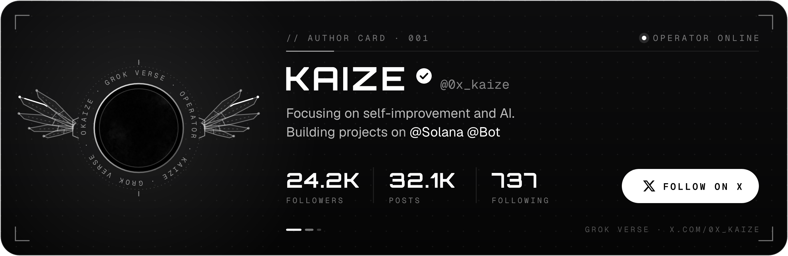

# Kaize-OS

Everything you need to get Impressions and Grow on X: how the algorithm works,
post patterns that earn reach, Grok prompts and Bots, and the best guides from other
creators.

<h2 align="center">Author</h2>

  

<h2 align="center">Contents</h2>

| | Section | What's inside |
|:---:|:---|:---|
| `01` | **[Setup & Niche](handbook/01-setup-and-niche.md)** | Profile, bio, positioning, choosing a niche |
| `02` | **[How the Algorithm Works](handbook/02-algorithm.md)** | What X actually rewards and what kills reach |
| `03` | **[Posting & Growth](handbook/03-posting-and-growth.md)** | Cadence, timing, replies, engagement loops |
| `04` | **[Tools](tools/README.md)** | Editing, scheduling, analytics, design |
| `05` | **[Grok Bots](grok/README.md)** | The bots worth using + how to use them |
| `06` | **[Using AI](ai/README.md)** | AI in your content workflow, prompts, pitfalls |
| `07` | **[Monetization](handbook/04-monetization.md)** | Creator payouts, sponsorships |
| `08` | **[Resources](resources/README.md)** | Best guides from other creators + accounts to study |
| `09` | **[Glossary](glossary.md)** | Terms for anyone starting from zero |

